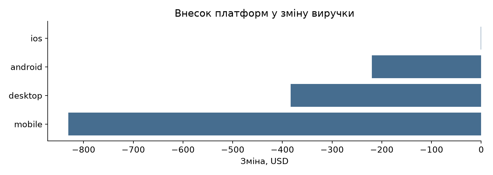

# Аналітичний асистент у Jupyter

Лабораторна робота № 4. Волошин Артем, ІС-31.

Асистент аналізує платежі мобільного застосунку на навчальних даних із лабораторної № 3.
Pandas обчислює метрики, а Qwen2.5 7B через локальний Ollama API створює текстові пояснення,
гіпотези та короткий підсумок. Модель отримує агрегати, а не рядки з ідентифікаторами користувачів.

Реалізовано чотири функції:
- `auto_eda(csv_or_df, client)` — типи, пропуски, повтори, розподіли, IQR-позначки та AI-інтерпретація.
- `suggest_hypotheses(payments, comparison, client)` — п’ять гіпотез із джерелами чисел і способом перевірки.
- `explain_metric_change(payments, before, after, metric, client)` — зміна виручки/кількості платежів і внески сегментів.
- `executive_summary(payments, comparison, client)` — три пункти для продакт-менеджера.

## Запуск у Jupyter

Розпакувати весь архів в окрему папку. Не переносити лише ipynb: потрібні модулі й папка data.
Відкрити Anaconda Prompt або PowerShell у цій папці:

```powershell
python -m pip install -r requirements.txt
python -m jupyterlab
```

Перевірене середовище — Python 3.12. Точні версії встановлених пакетів наведено
в `requirements-lock.txt`; для відтворення саме цього середовища можна встановити його
замість `requirements.txt`.

Відкрити `Лабораторна_4_Волошин_ІС-31.ipynb` і виконати **Kernel → Restart Kernel and Run All Cells**.
У ноутбуці є три режими:

| MODE | Що виконується |
|---|---|
| `saved` | Перерахунок метрик і перегляд збережених справжніх відповідей Ollama. Це початковий режим. |
| `live` | Нові звернення до локальної моделі. |
| `compute` | Тільки Pandas; AI-частина має статус `not_run`. |

У saved перевіряються модель, системний промпт, SHA-256 фактів і структура відповіді.
Якщо дані змінилися, стару відповідь використати не вдасться — потрібен новий live-запуск.

## Новий запуск моделі

Встановити Ollama з https://ollama.com/download/windows. Запустити застосунок Ollama.
Один раз завантажити модель:

```powershell
ollama pull qwen2.5:7b
ollama list
```

API-ключ і платна підписка не потрібні. API працює за адресою `http://127.0.0.1:11434`.
Якщо застосунок не запущений, можна виконати `ollama serve` в окремому терміналі;
якщо адреса вже зайнята, сервер, імовірно, працює — другий запуск не потрібний.

У першій комірці встановити `MODE = "live"`, `MODEL = "qwen2.5:7b"` і перезапустити весь ноутбук.
Результати зберігаються у `results/llm_runs`. Перший запит може бути повільнішим через завантаження ваг.
За потреби модель можна змінити одним рядком; якість іншої моделі потрібно перевірити окремо.

Альтернатива для перевірки тих самих чотирьох функцій без інтерфейсу Jupyter:

```powershell
python demo.py --live --model qwen2.5:7b
```

## Приклад розрахунків

```python
users, payments, rejected, audit = load_data("data")
change = explain_metric_change(
    payments,
    before=("2024-04-29", "2024-05-03"),
    after=("2024-05-06", "2024-05-10"),
    client=OllamaClient(model="qwen2.5:7b"),
)
print(format_analysis(change["analysis"]))
```

За однакові відрізки понеділок–п’ятниця виручка змінилася з 19 425,64 до 17 991,01 USD:
−1 434,63 USD, або −7,39%. Внесок mobile — −830,51 USD. Усі три розрізи окремо узгоджуються
із загальною зміною. Їх не можна додавати один до одного, оскільки це ті самі платежі.



Повні приклади AI-відповідей є у збережених виходах ноутбука та `results/*_live.txt`.
Вони містять також невдалі спроби у журналах: їх не приховано і не підмінено готовими шаблонами.

## Перевірки

```powershell
python -m unittest discover -s tests -v
```

Перевіряються порожні дані, пропуски, нескінченні значення, код країни NA, однакові/неправильні
періоди, нульова база, нові та зниклі сегменти, невідома метрика, помилкові JSON-відповіді,
вигадані числа, повторна спроба та сума реального набору незалежним підрахунком Decimal.
Мережевих звернень у модульних тестах немає; контрольні відповіді в них штучні й не є демо LLM.

## Файли та дані

- `analytics.py` — читання CSV, контроль якості, метрики, розкладання зміни.
- `assistant.py` — Ollama API, JSON-схема, валідатор, журнали, чотири функції.
- `prompts.py`, `prompts.md` — точні промпти та опис ітерацій.
- `demo.py` — запуск тих самих функцій для перевірки.
- `tests/` — автоматичні тести.
- `data/` — незмінені registrations (202 382 рядки), payments (11 330), country_info_dict (253).
- `results/` — метрики, графіки, відповіді та журнали.
- `Звіт_Лабораторна_4_Волошин_ІС-31.docx` — звіт.

Технології: Python, Pandas, NumPy, Matplotlib, JupyterLab, стандартний urllib, Ollama, Qwen2.5 7B.
Дані походять із наданого навчального архіву csv.zip лабораторної № 3. Повний набір не надсилається LLM.

## Межі результатів

Усі 10 комірок ноутбука виконано в новому середовищі, пройшли 22 тести.
Підсумок перевірки та назви чотирьох журналів: `results/final_verification.json`.
Статус `validated` означає проходження програмної перевірки, а не відсутність помилок у висновках.
У збереженому демо модель, зокрема, неправильно назвала ES Італією та припустила зростання
числа платників попри його падіння. У ноутбуці й звіті ці твердження розібрані та виправлені
окремими авторськими зауваженнями. Початкові відповіді LLM збережені без підміни.

JSON-схема контролює форму, а валідатор звіряє числа з указаними фактами з округленням до сотих.
Він не доводить правильність причин, напрямку порівняння або доречність кожного доказу.
Числа, записані словами, також потребують ручної перевірки. Великі платежі за IQR не видаляються автоматично.
Без transaction_id однакові рядки платежів не видаляються як дублікати без додаткового обґрунтування.
11 травня — неповний день, його немає в базовому порівнянні. Даних про рекламні витрати та релізи немає.


